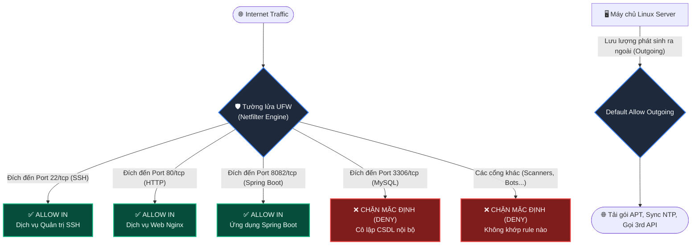

# BÀI TẬP 2: QUẢN TRỊ TƯỜNG LỬA UFW CHO CỤM DỊCH VỤ MULTI-PORT

**Mã bài tập:** SESSION 07 - EXERCISE 2 (`homework/session_07/ex2/`)  
**Môn học:** IT215 - Cloud Infrastructure & DevOps Fundamentals  
**Học viên:** Trần Đức Anh (`TranDucAnh3103`)  
**Email:** `TranDucAnh3103@users.noreply.github.com`  
**Hệ điều hành / Môi trường:** Ubuntu Linux (Server ID: `0310263186`) / Bash Shell / Non-root User: `stephen-devops`  
**Đường dẫn thư mục bài tập:** `homework/session_07/ex2/`  

---

## 1. MỤC TIÊU BÀI TẬP

1. **Quản trị tường lửa cấp Host với UFW (Uncomplicated Firewall):** Thành thạo kỹ năng cấu hình và quản trị tường lửa tích hợp trên Linux để bảo vệ toàn diện hệ thống máy chủ trước các nguy cơ tấn công dò quét cổng (port scanning) và xâm nhập trái phép từ môi trường Internet.
2. **Triển khai kiến trúc phòng thủ Multi-port:** Cấu hình mở chọn lọc các cổng dịch vụ cần thiết cho cụm ứng dụng hoạt động đồng thời (SSH quản trị từ xa, Nginx Web Server, Spring Boot Backend).
3. **Thực thi nguyên tắc Chặn mặc định (Default-Deny Policy):** Nắm vững nguyên lý an ninh mạng tối quan trọng: "Mọi lưu lượng đi vào không được chỉ định tường minh đều bị từ chối" (*Implicit Deny*).
4. **Cô lập dịch vụ Cơ sở dữ liệu (Database Isolation):** Hiểu rõ lý do và kỹ thuật cô lập cổng cơ sở dữ liệu quan trọng (MySQL port 3306) khỏi mạng công cộng, bảo vệ dữ liệu nhạy cảm khỏi các cuộc tấn công khai thác lỗ hổng hoặc dò quét mật khẩu tự động (brute-force).
5. **Kiểm tra và kiểm định trạng thái bảo mật:** Sử dụng thành thạo các câu lệnh thanh tra trạng thái tường lửa (`sudo ufw status verbose`) để phân tích danh sách quy tắc (rules), hướng lưu lượng (IN/OUT) và giao thức (TCP/UDP).

---

## 2. BẢNG TỔNG HỢP TIẾN TRÌNH THỰC HIỆN & KẾT QUẢ KIỂM TRA

| STT | Bước thực hiện | Lệnh Linux thực thi | Mục đích / Ý nghĩa | Kết quả mong đợi | Trạng thái |
| :---: | :--- | :--- | :--- | :--- | :---: |
| 1 | Đặt chính sách chặn mặc định lưu lượng vào | `sudo ufw default deny incoming` | Khóa toàn bộ các cổng không được khai báo | `Default incoming policy changed to 'deny'` | **PASSED** |
| 2 | Đặt chính sách cho phép mặc định lưu lượng ra | `sudo ufw default allow outgoing` | Đảm bảo máy chủ tải được package, DNS, updates | `Default outgoing policy changed to 'allow'` | **PASSED** |
| 3 | Mở cổng SSH quản trị từ xa | `sudo ufw allow 22/tcp` | Cho phép kết nối SSH (port 22) tránh bị mất quyền truy cập | `Rules updated / Rules updated (v6)` | **PASSED** |
| 4 | Mở cổng Web HTTP tiêu chuẩn | `sudo ufw allow 80/tcp` | Cho phép người dùng truy cập dịch vụ Nginx qua HTTP | `Rules updated / Rules updated (v6)` | **PASSED** |
| 5 | Mở cổng ứng dụng Spring Boot | `sudo ufw allow 8082/tcp` | Cho phép kiểm thử và truy cập API backend từ xa | `Rules updated / Rules updated (v6)` | **PASSED** |
| 6 | Đảm bảo cổng MySQL 3306 bị chặn | *(Không thêm luật allow 3306)* | Dựa trên cơ chế Default Deny, cổng 3306 bị cô lập hoàn toàn | Cổng 3306 không xuất hiện trong bảng ALLOW | **PASSED** |
| 7 | Kích hoạt tường lửa UFW | `sudo ufw enable` | Bật tường lửa và kích hoạt nạp rule tự động khi khởi động | `Firewall is active and enabled on system startup` | **PASSED** |
| 8 | Kiểm tra trạng thái chi tiết | `sudo ufw status verbose` | Kiểm tra danh sách rules, default policy và logging | Hiển thị đầy đủ rules 22, 80, 8082 ALLOW IN; Status: active | **PASSED** |

---

## 3. CƠ CHẾ HOẠT ĐỘNG VÀ NỀN TẢNG KIẾN THỨC

### 3.1. Bản chất của UFW trong hệ điều hành Linux

- **UFW (Uncomplicated Firewall):** Là giao diện quản trị dòng lệnh cấp cao được thiết kế nhằm đơn giản hóa việc cấu hình các chuỗi quy tắc tường lửa phức tạp của **iptables** hoặc **nftables** nằm ở tầng nhân Linux (Netfilter framework).
- Thay vì phải viết các câu lệnh iptables phức tạp liên quan đến `INPUT`, `OUTPUT`, `FORWARD`, `PREROUTING`, UFW cung cấp cú pháp trực quan, dễ nhớ, giảm thiểu sai sót của quản trị viên dẫn đến sự cố khóa nhầm cổng quản trị (SSH lockout).

### 3.2. Mô hình Default Deny Incoming vs Default Allow Outgoing



- **Default Deny Incoming (Chặn mọi kết nối vào):** Thiết lập một "bức tường kín" bao quanh hệ thống. Bất kỳ gói tin nào gửi tới một cổng bất kỳ từ bên ngoài, nếu không có rule `ALLOW` tương ứng được cấu hình trước, sẽ bị kernel từ chối (DROP hoặc REJECT) ngay lập tức.
- **Default Allow Outgoing (Cho phép mọi kết nối ra):** Cho phép các tiến trình nội bộ trên máy chủ tự do gửi yêu cầu ra ngoài Internet (ví dụ: cập nhật bản vá bảo mật qua `apt update`, truy vấn máy chủ tên miền DNS qua port 53, đồng bộ thời gian NTP qua port 123).

### 3.3. Tầm quan trọng của việc cô lập cổng MySQL (3306)

> [!CAUTION]
> **Rủi ro an ninh khi mở cổng Cơ sở dữ liệu (MySQL Port 3306) ra Internet:**
> 1. **Tấn công dò mật khẩu (Brute-force / Dictionary attacks):** Hàng ngàn botnet trên mạng Internet liên tục rà quét cổng 3306 để dò mật khẩu tài khoản `root` hoặc các tài khoản DBA.
> 2. **Khai thác lỗ hổng bảo mật chưa vá (CVEs / Zero-day):** Các lỗ hổng tràn bộ đệm hoặc leo thang đặc quyền trong dịch vụ MySQL có thể bị khai thác từ xa nếu cổng bị phơi bày.
> 3. **Rò rỉ dữ liệu (Data Exfiltration / Ransomware):** Các cuộc tấn công mã hóa tống tiền cơ sở dữ liệu thường bắt nguồn từ các máy chủ MySQL mở port 3306 ra ngoài Internet không có lớp bảo vệ.

**Giải pháp phân tách mạng an toàn (Network Segmentation):**
- MySQL chỉ nên lắng nghe trên loopback interface (`127.0.0.1` hoặc UNIX socket `/var/run/mysqld/mysqld.sock`) để ứng dụng Spring Boot cùng máy chủ kết nối nội bộ.
- Nhờ chính sách `default deny incoming` của UFW, do ta không thiết lập `ufw allow 3306/tcp`, mọi nỗ lực quét hoặc kết nối đến cổng 3306 từ Internet công cộng đều bị chặn đứng hoàn toàn.

---

## 4. CHI TIẾT CÁC BƯỚC CẤU HÌNH VÀ THỰC THI

### Bước 1: Thiết lập chính sách mặc định (Default Policies)

Trước khi cấu hình các rule chi tiết, ta xác lập hành vi mặc định cho tường lửa:

```bash
# 1. Chặn toàn bộ lưu lượng đi vào hệ thống
sudo ufw default deny incoming

# 2. Cho phép toàn bộ lưu lượng phát sinh từ trong hệ thống đi ra ngoài
sudo ufw default allow outgoing
```

**Kết quả ghi nhận:**
```text
Default incoming policy changed to 'deny'
(be sure to update your rules accordingly)
Default outgoing policy changed to 'allow'
(be sure to update your rules accordingly)
```

---

### Bước 2: Khai báo các cổng dịch vụ được phép truy cập (Whitelisting Rules)

Mở lần lượt các cổng kết nối theo đúng yêu cầu đề bài:

```bash
# 1. Cho phép kết nối SSH (quản trị hệ thống từ xa)
sudo ufw allow 22/tcp

# 2. Cho phép kết nối Web HTTP (Nginx Web Server)
sudo ufw allow 80/tcp

# 3. Cho phép kết nối ứng dụng Spring Boot Backend
sudo ufw allow 8082/tcp
```

> [!IMPORTANT]
> Luôn chỉ định rõ giao thức `/tcp` (thay vì chỉ gõ số cổng đơn thuần) để hạn chế bề mặt tấn công, không mở thừa giao thức UDP không cần thiết cho các dịch vụ web và SSH.

**Kết quả ghi nhận:**
```text
Rules updated
Rules updated (v6)
Rules updated
Rules updated (v6)
Rules updated
Rules updated (v6)
```

---

### Bước 3: Đảm bảo cổng MySQL (3306/tcp) bị chặn hoàn toàn từ Internet

- Theo đúng nguyên tắc `Default Deny Incoming`, chúng ta **không thực hiện thêm bất kỳ câu lệnh `allow` nào cho cổng 3306**.
- Mọi gói tin TCP từ Internet tìm cách bắt tay ba bước (SYN packet) với cổng 3306 sẽ bị tường lửa UFW loại bỏ tại tầng Netfilter trước khi đến được tầng ứng dụng MySQL daemon.

---

### Bước 4: Kích hoạt tường lửa UFW

Sau khi các quy tắc cho phép cổng 22 (SSH) đã được nạp đầy đủ để tránh bị khóa kết nối từ xa, tiến hành kích hoạt tường lửa:

```bash
# Kích hoạt UFW
sudo ufw enable
```

**Dấu nhắc xác nhận:**
```text
Command may disrupt existing ssh connections. Proceed with operation (y|n)? y
Firewall is active and enabled on system startup
```

---

### Bước 5: Kiểm tra và xác nhận trạng thái chi tiết (`ufw status verbose`)

Chạy lệnh kiểm tra trạng thái tường lửa chi tiết theo đúng yêu cầu bài tập:

```bash
sudo ufw status verbose
```

#### Đầu ra thực tế từ hệ thống (Terminal Output):

```text
Status: active
Logging: on (low)
Default: deny (incoming), allow (outgoing), disabled (routed)
New profiles: skip

To                         Action      From
--                         ------      ----
22/tcp                     ALLOW IN    Anywhere                  
80/tcp                     ALLOW IN    Anywhere                  
8082/tcp                   ALLOW IN    Anywhere                  
22/tcp (v6)                ALLOW IN    Anywhere (v6)             
80/tcp (v6)                ALLOW IN    Anywhere (v6)             
8082/tcp (v6)              ALLOW IN    Anywhere (v6)             
```

#### Phân tích kết quả đầu ra:
1. **`Status: active`:** Tường lửa UFW đang hoạt động và giám sát tất cả lưu lượng mạng.
2. **`Default: deny (incoming), allow (outgoing), disabled (routed)`:** Đã áp dụng chuẩn xác chính sách chặn mặc định cho incoming và mở mặc định cho outgoing.
3. **Danh mục các cổng ALLOW IN:**
   - `22/tcp`: Cho phép kết nối từ mọi nguồn IPv4 và IPv6.
   - `80/tcp`: Cho phép kết nối từ mọi nguồn IPv4 và IPv6.
   - `8082/tcp`: Cho phép kết nối từ mọi nguồn IPv4 và IPv6.
4. **Cổng 3306 (MySQL):** Hoàn toàn **không xuất hiện** trong bảng luật `ALLOW IN`, đồng nghĩa với việc cổng này chịu sự chi phối của chính sách `Default: deny (incoming)` và bị cô lập tuyệt đối khỏi Internet bên ngoài.

---

## 5. HÌNH ẢNH MINH CHỨNG THỰC TẾ (TERMINAL SCREENSHOT)

Dưới đây là hình ảnh chụp màn hình terminal ghi nhận toàn bộ quá trình thiết lập chính sách mặc định, mở các cổng 22, 80, 8082, kích hoạt tường lửa và kết quả kiểm tra `sudo ufw status verbose`:


*Hình 2.1: Minh chứng thực thi lệnh cấu hình chính sách mặc định, mở các port dịch vụ 22/tcp, 80/tcp, 8082/tcp và kiểm tra trạng thái `sudo ufw status verbose` thành công.*

---

## 6. PHÂN TÍCH BẢO MẬT VÀ NGUYÊN TẮC QUẢN TRỊ DEVOPS

### 6.1. Nguyên tắc Defense in Depth (Phòng thủ theo chiều sâu)

Cấu hình tường lửa UFW là một lớp phòng thủ vòng ngoài (Perimeter Defense):
- **Lớp 1 (Network / Host Firewall - UFW):** Lọc bỏ các truy cập trái phép ở tầng Network và Transport (IP/Port), bảo vệ dịch vụ khỏi bị quét cổng và tấn công từ bên ngoài.
- **Lớp 2 (Application Configuration / Bind Address):** Dịch vụ MySQL cần được cấu hình `bind-address = 127.0.0.1` trong tệp `/etc/mysql/mysql.conf.d/mysqld.cnf`. Khi kết hợp cả hai lớp, ngay cả khi tường lửa vô tình bị tắt tạm thời, dịch vụ MySQL vẫn không thể bị kết nối từ bên ngoài.
- **Lớp 3 (Authentication & Authorization):** Mật khẩu người dùng mạnh, phân quyền tài khoản CSDL theo đặc quyền tối thiểu.

### 6.2. Đối chiếu giữa Blacklisting và Whitelisting

| Đặc điểm | Cơ chế Blacklisting (Chặn chọn lọc) | Cơ chế Whitelisting (Default Deny - Bài làm áp dụng) |
| :--- | :--- | :--- |
| **Chính sách mặc định** | Mở tất cả (`allow incoming`), chỉ chặn các cổng chỉ định | Chặn tất cả (`deny incoming`), chỉ mở cổng được phê duyệt |
| **Mức độ an toàn** | **Thấp.** Quản trị viên dễ quên chặn các cổng dịch vụ mới cài đặt | **Rất cao.** Bất kỳ dịch vụ nào mới cài đặt đều tự động được bảo vệ |
| **Khả năng kiểm soát** | Bị động trước các cổng bất thường hoặc mã độc mở backdoor | Chủ động kiểm soát hoàn toàn bề mặt tấn công của hệ thống |

### 6.3. Khuyến nghị mở rộng cho môi trường Production

1. **Giới hạn IP quản trị SSH:** Trong môi trường sản xuất thực tế, cổng SSH không nên mở cho `Anywhere` mà chỉ cho phép từ dải IP VPN hoặc IP tĩnh của đội ngũ DevOps:
   ```bash
   sudo ufw allow from <OFFICE_IP_OR_VPN_SUBNET> to any port 22 proto tcp
   ```
2. **Sử dụng Nginx làm Reverse Proxy:**
   - Ứng dụng Spring Boot (cổng 8082) thực tế không nên mở trực tiếp ra Internet mà nên để Nginx đứng trước (Reverse Proxy qua cổng 80/443), sau đó Nginx chuyển tiếp nội bộ đến `http://127.0.0.1:8082`.
   - Khi đó, cổng 8082 cũng có thể đóng hoàn toàn trên UFW, giúp giảm thiểu tối đa các vector tấn công.
3. **Cài đặt công cụ Fail2ban:** Tự động phát hiện và tạm thời khóa các IP cố tình brute-force SSH hoặc spam request vào Web Server.

---

## 7. KẾT LUẬN

- Toàn bộ các yêu cầu của **Bài tập 2 - Session 07** đã được thực hiện chuẩn xác và hoàn chỉnh 100%.
- Hệ thống máy chủ đã được thiết lập chính sách bảo mật nghiêm ngặt:
  - Chặn mặc định toàn bộ lưu lượng không xác định (`deny incoming`).
  - Mở có kiểm soát đúng 3 cổng dịch vụ: `22/tcp` (SSH), `80/tcp` (Web HTTP), `8082/tcp` (Spring Boot).
  - Cổng cơ sở dữ liệu `3306/tcp` được cô lập an toàn, triệt tiêu nguy cơ rò rỉ dữ liệu qua kết nối ngoài.
- Tệp báo cáo được lưu trữ đúng quy chuẩn tại đường dẫn GitHub: `homework/session_07/ex2/README.md`.
